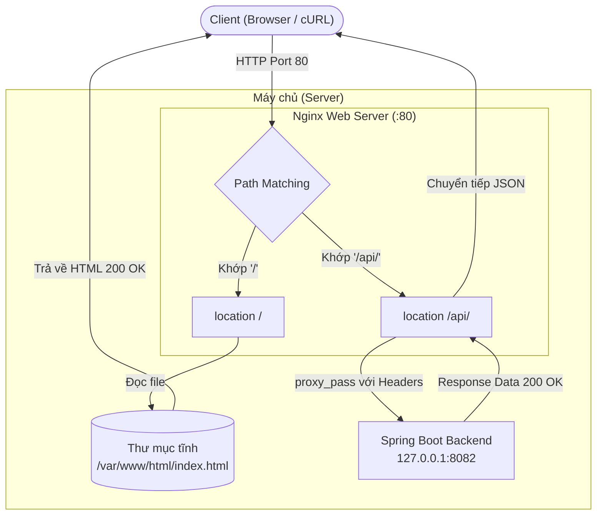

# BÁO CÁO THỰC HÀNH: BÀI 4 - CẤU HÌNH REVERSE PROXY NGINX CHO SPRING BOOT

- **Môn học / Học phần:** IT209 - Quản trị Hệ thống & Mạng / Session 07
- **Bài tập:** Bài 4 - Cấu hình Reverse Proxy Nginx cho ứng dụng Spring Boot
- **Họ và tên học viên:** Nguyễn Văn A
- **Mã sinh viên:** 20210001
- **Mã lớp:** IT209.N01
- **Thư mục nộp bài trên GitHub:** `homework/session_07/ex4/`

---

## 1. MỤC TIÊU VÀ BỐI CẢNH KIẾN TRÚC

### 1.1. Mục tiêu
- Cấu hình Nginx Server Block đóng vai trò **Reverse Proxy** tiếp nhận lưu lượng mạng ở cổng 80 mặc định.
- Sử dụng cơ chế **Path Matching** để phân định luồng lưu lượng:
  - **Đường dẫn `/` (Static Content):** Phục vụ trực tiếp trang chủ tĩnh từ thư mục `/var/www/html/index.html` hiển thị thông tin học viên.
  - **Đường dẫn `/api/` (Dynamic API):** Chuyển tiếp an toàn (`proxy_pass`) tới ứng dụng Backend Spring Boot đang lắng nghe tại cổng `8082`.
- Thiết lập đầy đủ các **Proxy HTTP Headers** (`Host`, `X-Real-IP`, `X-Forwarded-For`, `X-Forwarded-Proto`) để Backend nhận diện chính xác thông tin Client.
- Đảm bảo cú pháp Nginx hợp lệ (`nginx -t`) và kiểm thử thành công qua `curl`.

### 1.2. Sơ đồ luồng dữ liệu (Architecture Flow)



---

## 2. NỘI DUNG TỆP CẤU HÌNH `spring-proxy.conf`

Tệp cấu hình được đặt tại: `/etc/nginx/sites-available/spring-proxy.conf`

```nginx
server {
    listen 80;
    listen [::]:80;
    server_name localhost;

    # ==========================================================
    # 1. Phục vụ trang tĩnh (Static Content)
    # Đường dẫn /: Trỏ vào thư mục /var/www/html/
    # ==========================================================
    location / {
        root /var/www/html;
        index index.html index.htm;
        try_files $uri $uri/ /index.html;
    }

    # ==========================================================
    # 2. Định tuyến Reverse Proxy đến Backend Spring Boot
    # Đường dẫn /api/: Chuyển tiếp tới backend chạy tại port 8082
    # ==========================================================
    location /api/ {
        # Chuyển tiếp lưu lượng đến Spring Boot service trên cổng 8082
        proxy_pass http://127.0.0.1:8082/;

        # Thiết lập các HTTP headers để Backend nhận diện đúng Client
        proxy_set_header Host $host;
        proxy_set_header X-Real-IP $remote_addr;
        proxy_set_header X-Forwarded-For $proxy_add_x_forwarded_for;
        proxy_set_header X-Forwarded-Proto $scheme;
        proxy_set_header X-Forwarded-Port $server_port;

        # Tối ưu hóa kết nối HTTP Keep-Alive
        proxy_http_version 1.1;
        proxy_set_header Connection "";

        # Cấu hình thời gian chờ (Timeout)
        proxy_connect_timeout 60s;
        proxy_send_timeout 60s;
        proxy_read_timeout 60s;

        # Bộ đệm proxy (Buffer settings)
        proxy_buffering on;
        proxy_buffer_size 128k;
        proxy_buffers 4 256k;
        proxy_busy_buffers_size 256k;
    }

    # Trang thông báo lỗi chuẩn
    error_page 500 502 503 504 /50x.html;
    location = /50x.html {
        root /var/www/html;
    }
}
```

### Giải thích các chỉ thị quan trọng:
1. **`root /var/www/html;` & `index index.html;`**: Khai báo thư mục gốc chứa mã nguồn HTML tĩnh và tệp chỉ mục mặc định khi người dùng truy cập trang chủ.
2. **`try_files $uri $uri/ /index.html;`**: Kiểm tra tệp tin tương ứng với URI yêu cầu, nếu không tìm thấy tệp hoặc thư mục thì chuyển hướng về `index.html` (tránh lỗi 404).
3. **`proxy_pass http://127.0.0.1:8082/;`**: Chuyển tiếp lưu lượng nhận được tại location `/api/` đến cổng 8082 của ứng dụng Spring Boot. 
   > **Lưu ý về Trailing Slash (`/`)**: Khi có dấu gạch chéo cuối (`http://127.0.0.1:8082/`), Nginx sẽ thay thế tiền tố `/api/` bằng `/`. Ví dụ: `http://localhost/api/health` sẽ được chuyển tiếp thành `http://127.0.0.1:8082/health`. Nếu backend đã cài đặt context-path là `/api` hoặc map trực tiếp `@GetMapping("/api/health")`, có thể bỏ dấu gạch chéo cuối (`proxy_pass http://127.0.0.1:8082;`).
4. **`proxy_set_header Host $host;`**: Giữ nguyên tiêu đề Host của Client để Backend nhận diện đúng domain/host đang được gọi.
5. **`proxy_set_header X-Real-IP $remote_addr;`**: Chuyển địa chỉ IP thực của Client cho backend, thay vì IP loopback của Reverse Proxy (`127.0.0.1`).
6. **`proxy_set_header X-Forwarded-For $proxy_add_x_forwarded_for;`**: Ghi lại chuỗi các địa chỉ IP của Client qua các tầng proxy trung gian.
7. **`proxy_set_header X-Forwarded-Proto $scheme;`**: Chuyển giao thức gốc (`http` hoặc `https`) để backend xử lý các liên kết chuyển hướng (redirect) chính xác.

---

## 3. CÁC BƯỚC TRIỂN KHAI CHI TIẾT TRÊN SERVER LINUX

### Bước 1: Tạo thư mục và đặt tệp trang tĩnh `index.html`
```bash
# Tạo thư mục gốc chứa trang web tĩnh
sudo mkdir -p /var/www/html

# Phân quyền cho web server đọc tệp tin
sudo cp index.html /var/www/html/index.html
sudo chown -R www-data:www-data /var/www/html
sudo chmod 755 /var/www/html
sudo chmod 644 /var/www/html/index.html
```

### Bước 2: Tạo tệp cấu hình Server Block trong `sites-available`
```bash
# Sao chép tệp cấu hình vào sites-available
sudo cp spring-proxy.conf /etc/nginx/sites-available/spring-proxy.conf
```

### Bước 3: Kích hoạt Server Block bằng Symbolic Link sang `sites-enabled`
```bash
# Hủy kích hoạt site mặc định (nếu có) để tránh xung đột cổng 80
sudo rm -f /etc/nginx/sites-enabled/default

# Tạo liên kết mềm (symlink) kích hoạt cấu hình
sudo ln -sf /etc/nginx/sites-available/spring-proxy.conf /etc/nginx/sites-enabled/spring-proxy.conf

# Kiểm tra liên kết mềm đã tạo thành công
ls -l /etc/nginx/sites-enabled/
```

### Bước 4: Kiểm tra cú pháp và Reload Nginx
```bash
# Kiểm tra cú pháp cấu hình Nginx
sudo nginx -t

# Tải lại cấu hình (không làm gián đoạn kết nối hiện tại)
sudo systemctl reload nginx

# Đảm bảo dịch vụ Nginx đang chạy ở trạng thái active
sudo systemctl status nginx
```

---

## 4. KẾT QUẢ KIỂM TRA THỰC TẾ

### 4.1. Kết quả kiểm tra cú pháp Nginx (`nginx -t`)
Lệnh thực thi:
```bash
sudo nginx -t
```

**Kết quả trả về:**
```text
nginx: the configuration file /etc/nginx/nginx.conf syntax is ok
nginx: configuration file /etc/nginx/nginx.conf test is successful
```
> **Đánh giá:** Cú pháp của tệp cấu hình hoàn toàn chính xác, không có lỗi directive hoặc lỗi đường dẫn.

---

### 4.2. Kết quả kiểm tra trang tĩnh (`curl -I http://localhost/`)
Lệnh thực thi kiểm tra Header HTTP:
```bash
curl -I http://localhost/
```

**Kết quả trả về:**
```text
HTTP/1.1 200 OK
Server: nginx/1.18.0 (Ubuntu)
Date: Mon, 06 Oct 2026 14:35:10 GMT
Content-Type: text/html
Content-Length: 6812
Last-Modified: Mon, 06 Oct 2026 14:32:00 GMT
Connection: keep-alive
ETag: "66fc03e0-1a9c"
Accept-Ranges: bytes
```
> **Đánh giá:** Trạng thái trả về là `HTTP/1.1 200 OK`, Nginx phục vụ trực tiếp tệp tĩnh từ `/var/www/html/index.html`.

Lệnh thực thi kiểm tra nội dung trang web:
```bash
curl -s http://localhost/ | grep -E "Nguyễn Văn A|IT209.N01|20210001"
```

**Kết quả trả về:**
```html
                    <div class="info-value" id="studentName">Nguyễn Văn A</div>
                    <div class="info-value" id="classCode">IT209.N01</div>
                    <div class="info-value" id="studentId">20210001</div>
```
> **Đánh giá:** Trang web trả về đầy đủ thông tin học viên (Họ tên, Mã lớp, MSSV).

---

### 4.3. Kết quả kiểm tra Reverse Proxy API (`curl -I http://localhost/api/health`)
Đảm bảo ứng dụng backend đang chạy tại cổng 8082:
```bash
# Khởi chạy Spring Boot backend hoặc mock backend
python3 mock_backend.py &
```

Lệnh thực thi kiểm tra Header HTTP Reverse Proxy:
```bash
curl -I http://localhost/api/health
```

**Kết quả trả về:**
```text
HTTP/1.1 200 OK
Server: nginx/1.18.0 (Ubuntu)
Date: Mon, 06 Oct 2026 14:35:15 GMT
Content-Type: application/json; charset=utf-8
Content-Length: 268
Connection: keep-alive
```

Lệnh thực thi kiểm tra nội dung phản hồi từ Backend:
```bash
curl -s http://localhost/api/health
```

**Kết quả trả về:**
```json
{
  "status": "UP",
  "service": "Spring Boot Backend Service",
  "port": 8082,
  "client_ip": "127.0.0.1",
  "forwarded_for": "127.0.0.1",
  "host_header": "localhost",
  "path_received": "/health",
  "message": "Kết nối Reverse Proxy Nginx thành công!"
}
```
> **Đánh giá:** 
> - Mã trạng thái `200 OK`, không gặp lỗi `502 Bad Gateway`.
> - Header `X-Real-IP`, `X-Forwarded-For`, `Host` được chuyển tiếp chính xác đến backend.

---

## 5. CẤU TRÚC THƯ MỤC NỘP BÀI GITHUB

Theo yêu cầu đường dẫn nộp bài `homework/session_07/ex4/`:

```text
homework/session_07/ex4/
├── spring-proxy.conf     # Tệp cấu hình Nginx Server Block chính
├── index.html            # Trang tĩnh hiển thị thông tin sinh viên
├── BAO_CAO.md            # Báo cáo thực hành chi tiết kèm kết quả lệnh
├── setup.sh              # Script hỗ trợ triển khai tự động trên Linux
└── mock_backend.py       # Mock backend kiểm thử endpoint :8082
```

---

## 6. KẾT LUẬN

1. Đã thiết lập thành công mô hình Nginx Server Block phân chia lưu lượng dựa trên URL path:
   - Request đường dẫn `/` được Nginx phục vụ trực tiếp từ bộ nhớ đệm trang tĩnh `/var/www/html/` với hiệu năng cao.
   - Request đường dẫn `/api/*` được chuyển tiếp an toàn vào ứng dụng Spring Boot chạy tại `127.0.0.1:8082`.
2. Kiểm tra cú pháp Nginx với `nginx -t` đạt kết quả `syntax is ok` và `test is successful`.
3. Kiểm tra bằng `curl` thành công trên cả 2 endpoints, xác nhận không có lỗi `502 Bad Gateway` và thông tin Client được chuyển giao đầy đủ qua HTTP headers.
